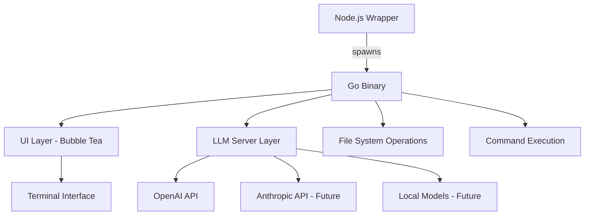
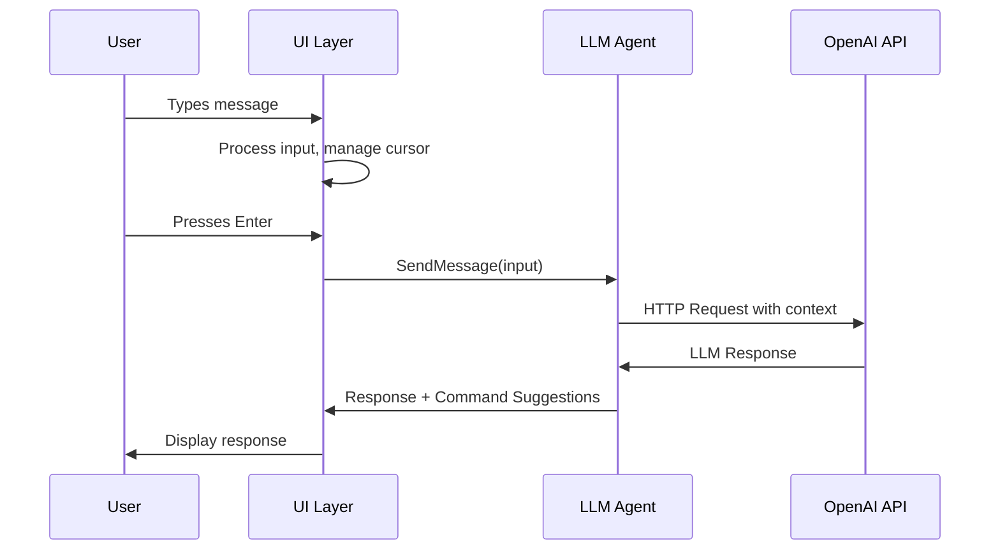
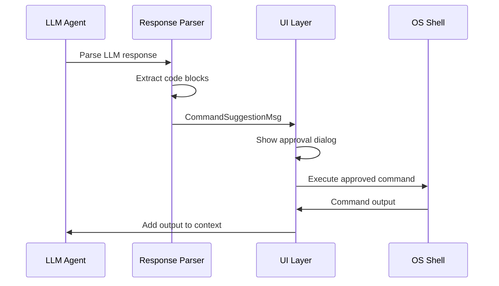

# Architecture Overview

Menace CLI is built with a hybrid architecture that combines Go's performance with Node.js's cross-platform ecosystem. This document explains the system design, key components, and architectural decisions.

## High-Level Architecture



## System Components

### 1. Node.js Wrapper Layer

**Location**: `menace-cli/bin/menace.js`

The Node.js wrapper serves as the entry point and platform abstraction:

```javascript
// Platform detection
switch (process.platform) {
    case "win32":
        binName = "menace-go-win.exe";
        break;
    case "darwin":
        binName = process.arch === "arm64" ? 
            "menace-go-darwin-arm64" : "menace-go-darwin";
        break;
    case "linux":
        binName = "menace-go-linux";
        break;
}
```

**Responsibilities**:
- Platform-specific binary selection
- Process spawning and management  
- npm ecosystem integration
- Cross-platform compatibility

### 2. Go Application Core

**Location**: `menace-cli/src/`

The Go application provides the main functionality:

#### Main Entry Point (`main.go`)
```go
func main() {
    // API key validation
    apiKey := os.Getenv("OPENAI_API_KEY")
    
    // Agent initialization
    agent, err := llmServer.NewAgent(apiKey)
    
    // UI initialization with Bubble Tea
    p := tea.NewProgram(
        ui.NewModel(agent),
        tea.WithAltScreen(),
        tea.WithMouseAllMotion(),
    )
}
```

### 3. LLM Server Layer

**Location**: `menace-cli/src/llmServer/`

The LLM server handles all AI-related functionality:

#### Key Components:

**Agent (`agent.go`)**:
- LLM client management (OpenAI, Anthropic)
- Context and conversation history
- Shell detection and adaptation
- Function calling capabilities

**LLM Service (`llmService.go`)**:
- Singleton pattern for service management
- Model selection and configuration
- Message history management
- HTTP client for API communication

**Model Factory (`llmFactory.go`)**:
- Cross-platform shell detection
- Model provider abstraction
- Configuration management

### 4. User Interface Layer

**Location**: `menace-cli/src/ui/`

Built with [Bubble Tea](https://github.com/charmbracelet/bubbletea), providing:

#### Core UI Components:

**Model (`model.go`)**:
- Application state management
- Input handling and cursor management
- Message history and display
- Selection and clipboard operations

**View (`view.go`)**:
- Terminal rendering
- Chat interface layout
- Syntax highlighting
- Mouse interaction support

**Message System (`message.go`)**:
- Inter-component communication
- Async operation handling
- Command suggestion workflow

## Data Flow

### 1. User Input Processing



### 2. Command Suggestion Flow



## Key Architectural Decisions

### 1. Hybrid Go + Node.js Architecture

**Why Go?**
- High performance for TUI rendering
- Excellent concurrency for async operations
- Strong typing for reliability
- Cross-compilation capabilities

**Why Node.js Wrapper?**
- npm ecosystem integration
- Familiar deployment model
- Platform abstraction
- Package management

### 2. Bubble Tea for UI

**Benefits**:
- Reactive architecture
- Excellent terminal capabilities
- Mouse support
- Compositional design

### 3. LangChain Go Integration

**Advantages**:
- Standardized LLM interface
- Multiple provider support
- Built-in retry logic
- Streaming capabilities

### 4. Singleton Pattern for LLM Service

**Rationale**:
- Single API client instance
- Shared conversation context
- Resource efficiency
- Simplified state management

## Memory and Performance Considerations

### Context Management
```go
type Agent struct {
    messages []llms.MessageContent  // Conversation history
    mu       sync.Mutex            // Thread safety
    // ...
}
```

**Current Limitations**:
- Unlimited message history growth
- No context window management
- Memory usage increases over time

**Future Improvements**:
- Context window awareness
- Message pruning strategies
- Directory-specific contexts

### Concurrency Model

```go
// Thread-safe model updates
func (s *LLMService) SendMessage(input string) (*ChatResponse, error) {
    s.mu.Lock()
    defer s.mu.Unlock()
    // ... safe operations
}
```

## Cross-Platform Considerations

### Shell Detection
```go
func (mf ModelFactory) DetectShell() string {
    switch runtime.GOOS {
    case "windows":
        return "windows/powershell"
    case "darwin", "linux":
        return runtime.GOOS + "/bash"
    }
}
```

### Binary Management
- Platform-specific binaries built via Go's cross-compilation
- Node.js wrapper selects appropriate binary
- Build scripts handle all target platforms

## Security Considerations

### API Key Management
- Environment variable storage only
- No file-based key storage
- Key validation on startup

### Command Execution
- User approval required for all commands
- Shell injection prevention
- Sandboxed execution context

## Extension Points

### 1. New LLM Providers
```go
// Add new providers to agent.go
llm, err := anthropic.New(
    anthropic.WithToken(apiKey),
)
```

### 2. Custom Functions
```go
// Extend function calling in agent.go
case "customFunction":
    return executeCustomFunction(args)
```

### 3. UI Components
```go
// Add new UI components to ui/
type CustomComponent struct {
    // Component state
}

func (c CustomComponent) Update(msg tea.Msg) (tea.Model, tea.Cmd) {
    // Update logic
}
```

## Build System Architecture

The build system uses Node.js scripts to orchestrate Go cross-compilation:

```javascript
const buildTargets = [
    { os: "linux", arch: "amd64", output: "menace-go-linux" },
    { os: "darwin", arch: "amd64", output: "menace-go-darwin" },
    { os: "darwin", arch: "arm64", output: "menace-go-darwin-arm64" },
    { os: "windows", arch: "amd64", output: "menace-go-win.exe" },
];
```

This architecture provides a robust foundation for a cross-platform AI-powered terminal assistant while maintaining good separation of concerns and extensibility.