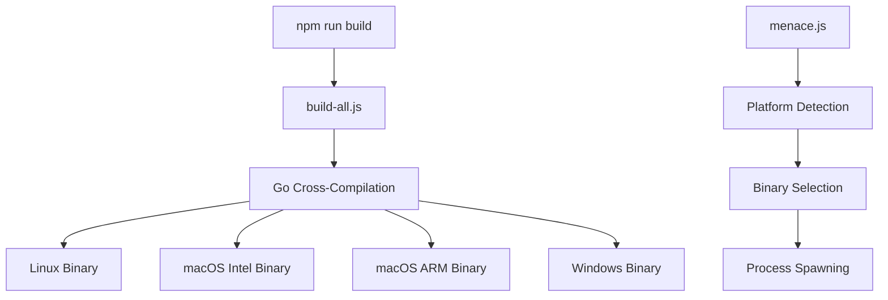

# Build System

Comprehensive guide to Menace CLI's build system, including cross-platform compilation, packaging, and distribution.

## Overview

Menace CLI uses a hybrid build system that combines:
- **Node.js scripts** for orchestration and platform detection
- **Go cross-compilation** for creating native binaries
- **npm packaging** for distribution and dependency management

## Build Architecture



## Build Scripts

### Main Build Script (`scripts/build-all.js`)

The primary script that builds binaries for all supported platforms:

```javascript
const buildTargets = [
  { os: "linux", arch: "amd64", output: "menace-go-linux" },
  { os: "darwin", arch: "amd64", output: "menace-go-darwin" },
  { os: "darwin", arch: "arm64", output: "menace-go-darwin-arm64" },
  { os: "windows", arch: "amd64", output: "menace-go-win.exe" },
];

const goModDir = path.resolve(__dirname, "../src");
const binDir = path.resolve(__dirname, "../bin");

for (const {os: GOOS, arch: GOARCH, output} of buildTargets) {
    const outPath = path.join(binDir, output);
    console.log(`Building for ${GOOS}/${GOARCH} → ${output}`);
    
    execSync(
        `go build -o "${outPath}" .`,
        {
            stdio: "inherit",
            cwd: goModDir,
            env: { ...process.env, GOOS, GOARCH }
        }
    );
}
```

### Platform-Specific Scripts

#### macOS Build (`scripts/build-mac.js`)

Builds only macOS binaries (Intel and Apple Silicon):

```javascript
const targets = [
  { os: "darwin", arch: "amd64", output: "menace-go-darwin" },
  { os: "darwin", arch: "arm64", output: "menace-go-darwin-arm64" },
];
```

#### Windows Build (`scripts/build-windows.js`)

Builds only Windows executable:

```javascript
const targets = [
  { os: "windows", arch: "amd64", output: "menace-go-win.exe" },
];
```

## Binary Wrapper System

### Node.js Wrapper (`bin/menace.js`)

The wrapper script provides cross-platform compatibility:

```javascript
#!/usr/bin/env node

const { spawn } = require("child_process");
const path = require("path");

// Platform detection
let binName;
switch (process.platform) {
    case "win32":
        binName = "menace-go-win.exe";
        break;
    case "darwin":
        binName = process.arch === "arm64" ? 
            "menace-go-darwin-arm64" : "menace-go-darwin";
        break;
    case "linux":
        binName = "menace-go-linux";
        break;
    default:
        console.error(`Unsupported platform: ${process.platform}`);
        process.exit(1);
}

// Binary execution
const binPath = path.join(__dirname, binName);
const child = spawn(binPath, [], { stdio: "inherit" });

child.on("error", (err) => {
    console.error(`Failed to start process: ${err.message}`);
    process.exit(1);
});
```

## Build Commands

### NPM Scripts

Defined in `package.json`:

```json
{
  "scripts": {
    "build": "node scripts/build-all.js",
    "build-windows": "node scripts/build-windows.js", 
    "build-mac": "node scripts/build-mac.js",
    "test": "echo \"Error: no test specified\" && exit 1"
  }
}
```

### Usage Examples

```bash
# Build all platforms
npm run build

# Build specific platforms
npm run build-mac
npm run build-windows

# Development build (current platform only)
cd src && go build -o ../bin/menace-go-dev .

# Debug build with symbols
cd src && go build -gcflags="all=-N -l" -o ../bin/menace-go-debug .
```

## Cross-Platform Considerations

### Supported Platforms

| Platform | Architecture | Binary Name | Notes |
|----------|--------------|-------------|-------|
| Linux | amd64 | `menace-go-linux` | Most Linux distributions |
| macOS | amd64 | `menace-go-darwin` | Intel Macs |
| macOS | arm64 | `menace-go-darwin-arm64` | Apple Silicon Macs |
| Windows | amd64 | `menace-go-win.exe` | Windows 10/11 |

### Platform-Specific Features

**Windows:**
- Uses PowerShell as default shell
- Includes `.exe` extension
- Handles Windows path separators

**macOS:**
- Universal binary support through separate ARM64/Intel builds
- Native shell detection (zsh/bash)
- Proper code signing (future enhancement)

**Linux:**
- Broad distribution compatibility
- Shell detection across various environments
- Static linking for portability

## Build Optimization

### Compiler Flags

#### Standard Build
```bash
go build -o menace-go .
```

#### Optimized Build
```bash
go build -ldflags="-s -w" -o menace-go .
```

#### Debug Build
```bash
go build -gcflags="all=-N -l" -o menace-go-debug .
```

### Build Flags Explanation

**`-ldflags="-s -w"`:**
- `-s`: Strip symbol table and debug info
- `-w`: Strip DWARF debug info
- Result: Smaller binary size

**`-gcflags="all=-N -l"`:**
- `-N`: Disable optimizations
- `-l`: Disable inlining
- Result: Better debugging experience

### Build Time Optimization

**Parallel Builds:**
```javascript
// Build targets in parallel
const builds = buildTargets.map(target => {
    return new Promise((resolve, reject) => {
        const child = spawn('go', ['build', ...], {
            env: { ...process.env, GOOS: target.os, GOARCH: target.arch }
        });
        child.on('close', code => {
            code === 0 ? resolve() : reject();
        });
    });
});

await Promise.all(builds);
```

**Incremental Builds:**
```bash
# Only rebuild if source changed
if [ src/*.go -nt bin/menace-go-linux ]; then
    go build -o bin/menace-go-linux .
fi
```

## Dependency Management

### Go Modules (`go.mod`)

```go
module menace-go

go 1.24.1

require (
    github.com/charmbracelet/bubbletea v1.3.5
    github.com/charmbracelet/lipgloss v1.1.0
    github.com/charmbracelet/x/cellbuf v0.0.13
    github.com/mattn/go-runewidth v0.0.16
)
```

### Dependency Updates

```bash
# Update all dependencies
go get -u ./...

# Update specific dependency
go get -u github.com/charmbracelet/bubbletea@latest

# Tidy module file
go mod tidy
```

### Vulnerability Scanning

```bash
# Check for vulnerabilities
go list -json -deps ./... | nancy sleuth

# Audit dependencies
go mod download -json | audit
```

## Advanced Build Configurations

### Version Injection

Inject version information at build time:

```javascript
// In build scripts
const version = require('../package.json').version;
const ldflags = `-X main.version=${version}`;

execSync(
    `go build -ldflags="${ldflags}" -o "${outPath}" .`,
    { /* ... */ }
);
```

```go
// In main.go
var version string

func main() {
    if version != "" {
        fmt.Printf("Menace CLI v%s\n", version)
    }
    // ... rest of main
}
```

### Build Tags

Use build tags for conditional compilation:

```go
//go:build debug
// +build debug

package main

import "log"

func init() {
    log.SetFlags(log.LstdFlags | log.Lshortfile)
}
```

Build with tags:
```bash
go build -tags debug -o menace-go-debug .
```

### Custom Binary Names

```javascript
// Dynamic binary naming
const timestamp = new Date().toISOString().slice(0, 10);
const output = `menace-go-${target.os}-${timestamp}`;
```

## Continuous Integration

### GitHub Actions Workflow

```yaml
name: Build and Test

on: [push, pull_request]

jobs:
  build:
    runs-on: ubuntu-latest
    strategy:
      matrix:
        os: [ubuntu-latest, windows-latest, macos-latest]
        go-version: [1.18, 1.19]
    
    steps:
    - uses: actions/checkout@v3
    
    - name: Set up Go
      uses: actions/setup-go@v3
      with:
        go-version: ${{ matrix.go-version }}
    
    - name: Set up Node.js
      uses: actions/setup-node@v3
      with:
        node-version: '16'
    
    - name: Install dependencies
      run: |
        cd menace-cli
        npm install
    
    - name: Build
      run: |
        cd menace-cli
        npm run build
    
    - name: Test
      run: |
        cd menace-cli/src
        go test ./...
    
    - name: Upload artifacts
      uses: actions/upload-artifact@v3
      with:
        name: binaries-${{ matrix.os }}
        path: menace-cli/bin/
```

## Troubleshooting Build Issues

### Common Problems

#### 1. Go Module Issues

**Problem:** `go: cannot find main module`
```bash
Error: go: cannot find main module, but found .git/config
```

**Solution:**
```bash
cd src  # Make sure you're in the directory with go.mod
go mod tidy
```

#### 2. Cross-Compilation Failures

**Problem:** CGO issues when cross-compiling
```bash
Error: cgo: C compiler "gcc" not found
```

**Solution:**
```bash
# Disable CGO for cross-compilation
CGO_ENABLED=0 go build -o menace-go .
```

#### 3. Missing Dependencies

**Problem:** Import errors during build
```bash
Error: package github.com/some/package: cannot find package
```

**Solution:**
```bash
go mod download
go mod tidy
```

#### 4. Permission Issues

**Problem:** Cannot create binary files
```bash
Error: permission denied
```

**Solution:**
```bash
# Ensure bin directory exists and is writable
mkdir -p bin
chmod 755 bin
```

### Debug Build Issues

**Enable verbose output:**
```bash
go build -v -x -o menace-go .
```

**Check build environment:**
```bash
go env
go version
```

## Packaging and Distribution

### NPM Package Structure

```
menace-cli/
├── package.json          # Package metadata
├── bin/
│   ├── menace.js         # Entry point script
│   ├── menace-go-linux   # Platform binaries
│   ├── menace-go-darwin
│   ├── menace-go-darwin-arm64
│   └── menace-go-win.exe
└── README.md
```

### Package.json Configuration

```json
{
  "name": "menace-cli",
  "version": "1.0.0",
  "bin": {
    "menace": "./bin/menace.js"
  },
  "files": [
    "bin/",
    "README.md",
    "LICENSE"
  ],
  "engines": {
    "node": ">=14.0.0"
  },
  "os": ["win32", "darwin", "linux"]
}
```

### Publishing Process

```bash
# Prepare for publishing
npm run build
npm test

# Update version
npm version patch  # or minor, major

# Publish to npm
npm publish

# Tag release
git tag v$(node -p "require('./package.json').version")
git push --tags
```

This build system provides robust cross-platform support while maintaining simplicity and reliability. The hybrid approach leverages the strengths of both Node.js and Go ecosystems.